# Concepts

This page explains what remblais computes and the parameters that control it.
The vocabulary is the one of GeomLoss.

## Measures

remblais compares two **measures**: distributions of mass over space. In
practice, a measure is a cloud of points `x` of shape `(N, D)`, together with
a weight per point `a` of shape `(N,)`. The weights are nonnegative; for
probability measures, they sum to 1.

```python
import torch
from remblais import SamplesLoss

device = "cuda"

x = torch.randn(1_000, 2, device=device)        # α: positions
a = torch.rand(1_000, device=device)
a = a / a.sum()                                  # α: weights, total mass 1
y = torch.randn(1_500, 2, device=device) + 1.0   # β: positions
b = torch.full((1_500,), 1 / 1_500, device=device)
```

A loss accepts three calling conventions:

- `loss(x, y)`: uniform weights, 1/N and 1/M;
- `loss(a, x, b, y)`: explicit weights;
- `loss(l_x, a, x, l_y, b, y)`: explicit weights and explicit cluster labels,
  for the `multiscale` backend.

A leading batch dimension computes B independent losses at once: `x` of shape
`(B, N, D)`, `a` of shape `(B, N)`, and the result has shape `(B,)`.

```python
loss = SamplesLoss("sinkhorn", blur=0.05)
print(loss(a, x, b, y))                          # a scalar

xb = torch.randn(4, 500, 2, device=device)
yb = torch.randn(4, 600, 2, device=device)
print(loss(xb, yb).shape)                        # torch.Size([4])
```

Images and volumes are measures too: densities on a regular grid. They have
their own function, described in [Images and volumes](guides/images.md).

## Losses

The `loss` argument of `SamplesLoss` picks the family:

- `"sinkhorn"`: the **Sinkhorn divergence**, a debiased entropic optimal
  transport cost. It behaves like the Wasserstein distance at small blur, and
  like a kernel norm at large blur. See
  [Sinkhorn divergences between point clouds](guides/sinkhorn.md).
- `"gaussian"`, `"laplacian"`, `"energy"`: **kernel norms**, also known as
  maximum mean discrepancies (MMD). Cheap and smooth, but with weaker
  gradients far from the target. See [Kernel MMD](guides/kernels.md).
- `"hausdorff"`: a **Hausdorff divergence**, a soft version of the distances
  used by ICP registration. See [Hausdorff divergence](guides/hausdorff.md).

## Costs

The ground cost `C(x, y)` says how much it costs to move a unit of mass from
`x` to `y`. With the default `cost=None`, it depends on `p`:

- `p=2` (the default): `C(x, y) = ½‖x − y‖²`;
- `p=1`: `C(x, y) = ‖x − y‖`.

A custom cost is a Python function of symbolic kernox formulas: it receives
`x`, indexed by `i`, and `y`, indexed by `j`, and returns a scalar formula.
kernox simplifies it, differentiates it and compiles it into a fused GPU
kernel; `backend="auto"` then always selects the `online` backend:

```python
loss_l1 = SamplesLoss("sinkhorn", p=1, blur=0.05, cost=lambda x, y: (x - y).norm2())
print(loss_l1(x, y))
```

Every kernox operation is available (`kp.log`, `kp.clamp`, `kp.where`,
`x.dot(y)`, components `x[0]`, ...; see the
[kernox operations](https://keckj.github.io/kernox/operations/)). Anisotropic
costs are a typical use:

```python
import kernox as kp

scales = (1.0, 4.0)

def anisotropic(x, y):      # x, y: kernox formulas of dimension 2
    d = x - y
    return (scales[0] * d[0] ** 2 + scales[1] * d[1] ** 2) / 2

loss = SamplesLoss("sinkhorn", blur=0.05, cost=anisotropic)
print(loss(x, y))
```

The values of `scales` are part of the formula: the reduction is compiled for
them, once.

The `tensorized` and `multiscale` backends work on dense cost matrices. To use
them with a custom cost, give a `(formula, dense routine)` pair, where the
routine receives tensors of shape `(B, N, D)` and `(B, M, D)` and returns the
cost matrix `(B, N, M)`. With `backend="tensorized"`, a plain function on
tensors is also accepted, as in GeomLoss.

KeOps formula strings such as `"Norm2(X-Y)"` are not supported: write the
formula with kernox, as above.

## Blur, reach and scaling

These parameters have a geometric meaning: they are lengths, in the units of
your data.

- **`blur`** (σ) is the scale below which details are ignored. Entropic
  regularization uses ε = blurᵖ. A small blur gives a sharper, more faithful
  transport, at the price of more iterations. A typical value is a small
  fraction of the size of your data, such as 0.01 to 0.05 for data in the
  unit cube. For kernel losses, `blur` is the width of the kernel.
- **`reach`** (ρ = reachᵖ) enables **unbalanced** transport. With the default
  `reach=None`, all the mass must be transported, and the two measures must
  have the same total mass. With a finite reach, mass may also be created or
  destroyed, at a cost: points farther apart than about `reach` are not
  matched. It makes the loss robust to outliers.
- **`scaling`** controls ε-scaling, the annealing strategy of the Sinkhorn
  loop. The loop starts at a blur as large as the data (the `diameter`,
  estimated if not given) and multiplies it by `scaling` at each iteration,
  down to `blur`. Values close to 1 are more accurate and slower; 0.5 is fast
  and 0.9 is precise.

```python
precise = SamplesLoss("sinkhorn", blur=0.01, scaling=0.9)
robust = SamplesLoss("sinkhorn", blur=0.01, reach=0.5)
print(precise(a, x, b, y), robust(a, x, b, y))
```

`debias=True` (the default) subtracts the self-transport terms, so that the
divergence of a measure with itself is zero. `potentials=True` returns the
dual potentials (F, G) instead of the value; see the
[Sinkhorn guide](guides/sinkhorn.md#dual-potentials).

## Backends

The `backend` argument chooses how the N × M interactions are computed. All
backends compute the same quantity; they differ in speed and memory.

- **`tensorized`**: dense PyTorch matrices of size N × M. Fast for small
  problems, but the memory grows quadratically. It is pure PyTorch, like the
  same backend of GeomLoss.
- **`online`**: each softmin is a single fused kernox reduction, computed
  without storing the N × M matrix: memory stays linear. The reduction is
  compiled once and reused for every value of ε, every call and every batch.
- **`multiscale`**: for Sinkhorn divergences in dimension 1 to 3. Points are
  clustered on a grid; the first iterations run on the cluster centroids,
  then the final ones skip the blocks of pairs that are too far apart to
  matter (block-sparse kernox reductions). It is the fastest choice for large
  clouds in 2D and 3D. `truncate` (default 5) sets how negligible an
  interaction must be to be skipped, and `cluster_scale` the size of the grid
  cells.

The default, `backend="auto"`, uses the rule of GeomLoss: `tensorized` when
N · M ≤ 5000², `multiscale` for Sinkhorn with `p=2` in dimension 3 or less
when N · M > 10⁴ · 10⁴, and `online` otherwise.



```python
big_x = torch.rand(5_000, 2, device=device)
big_y = torch.rand(5_000, 2, device=device)
for backend in ("online", "multiscale"):
    loss = SamplesLoss("sinkhorn", blur=0.05, backend=backend)
    print(backend, loss(big_x, big_y).item())
```

The two values are close but not identical: `multiscale` drops interactions
that are negligible at the chosen `truncate`.

## Precision and fast math

remblais works in FP32 and FP64 (and FP16 where kernox supports it), in the
dtype of your tensors. Like GeomLoss with PyKeOps, remblais uses approximate
`exp` and `log` by default on NVIDIA GPUs in FP32. Pass `fast_math=False` to
keep IEEE arithmetic everywhere; see
[Coming from GeomLoss](geomloss.md#fast-math).
Subnormal numbers are flushed to zero by default on the CPU and on NVIDIA
GPUs in FP32, which makes narrow kernels faster without changing the losses;
pass `flush_denormals=False` to keep them, see
[Subnormal numbers](geomloss.md#subnormal-numbers).
