# Gradient flows

A gradient flow moves the points of a source cloud, step by step, along the
gradient of a loss, until they cover the target. It is the simplest way to
see what a loss "pulls" on, and the core of many registration and generative
modelling methods.

## A Sinkhorn flow

We start from a blob and flow it onto a ring.

```python
import math

import torch
from remblais import SamplesLoss

device = "cuda"
torch.manual_seed(0)

N, M = 1_000, 1_000
x = 0.1 * torch.randn(N, 2, device=device) + 0.5
t = 2 * math.pi * torch.rand(M, device=device)
y = 0.5 + 0.3 * torch.stack([t.cos(), t.sin()], dim=1)

a = torch.full((N,), 1 / N, device=device)
b = torch.full((M,), 1 / M, device=device)
loss = SamplesLoss("sinkhorn", p=2, blur=0.01, scaling=0.9)
```

At each step, the gradient with respect to `x` is divided by the weights `a`:
`-grad / a` is then the displacement each point should follow, independently
of the number of points.

```python
lr = 1.0
x.requires_grad_()
for step in range(20):
    L = loss(a, x, b, y)
    [g] = torch.autograd.grad(L, [x])
    with torch.no_grad():
        x -= lr * g / a[:, None]
    if step % 5 == 0:
        print(f"step {step:2d}: loss = {L.item():.5f}")
```

With `p=2` and a small blur, a step of `lr = 1` moves each point almost
straight to its target: the loss collapses in a handful of steps. Smaller
steps give a smoother trajectory, here with `lr = 0.25`:



## Comparing losses

The same loop works with any loss of remblais. Kernel norms are cheaper per
step, but their gradients do not point straight at the target: they need
more steps, and a step size suited to the blur (a Gaussian kernel with a
small blur has steep gradients). The Sinkhorn divergence moves every point
along a nearly straight line.

```python
def flow(loss, lr, steps=10):
    z = (0.1 * torch.randn(N, 2, device=device) + 0.5).requires_grad_()
    for _ in range(steps):
        [g] = torch.autograd.grad(loss(a, z, b, y), [z])
        with torch.no_grad():
            z -= lr * g / a[:, None]
    return SamplesLoss("sinkhorn", blur=0.01)(a, z.detach(), b, y).item()

print("sinkhorn", flow(SamplesLoss("sinkhorn", blur=0.01), lr=0.5))
print("energy  ", flow(SamplesLoss("energy"), lr=0.5))
print("gaussian", flow(SamplesLoss("gaussian", blur=0.1), lr=0.05))
```

The printed number is the Sinkhorn divergence that remains between the
flowed cloud and the ring, after 10 steps: lower is better. The Sinkhorn
flow ends well below the two kernel flows.

## Tips

- Use `scaling=0.9` (or more) in a flow: the gradient of the Sinkhorn
  divergence is more accurate when the loop converges further.
- For large clouds on a GPU, `backend="online"` or `"multiscale"` (in 2D and
  3D) keeps the memory linear in the number of points.
- With an optimizer such as `torch.optim.SGD`, remember that the raw gradient
  scales with the weights: either divide by `a`, as above, or rescale the
  learning rate by $N$.
