# Images and volumes

Densities on a regular grid, such as grayscale images or 3D volumes, are
measures too: each pixel is a point of the unit square, weighted by its
intensity. remblais compares them with a multiscale Sinkhorn divergence that
exploits the grid: the cost is separable, so each softmin is a sequence of 1D
reductions, one per axis, instead of a reduction over all pairs of pixels.

GeomLoss 0.3.1 exposes this as the function `geomloss.sinkhorn_divergence`,
and remblais keeps the same name and signature. There is no separate
`ImagesLoss` class: images go through this function.

## Sinkhorn divergence between images

Images have shape `(B, K, N, N)`: a batch of B samples with K channels each.
Volumes have shape `(B, K, N, N, N)`. N must be a power of 2. Each channel is
a measure; normalize it so that it sums to 1.

```python
import torch
import remblais

device = "cuda"
torch.manual_seed(0)

N = 32

def random_images(B):
    img = torch.rand(B, 1, N, N, device=device) ** 4
    return img / img.sum(dim=(2, 3), keepdim=True)

a = random_images(2)
b = random_images(2)

value = remblais.sinkhorn_divergence(a, b)
print(value.shape)   # torch.Size([2]): one value per sample, summed over channels
```

The pixels sit on the grid [0, 1)² with a step of 1/N, and the default blur
is one pixel, 1/N. The other parameters (`p`, `reach`, `scaling`, `debias`,
`potentials`) have the same meaning as for [point clouds](sinkhorn.md).

The divergence is differentiable with respect to the pixel values:

```python
a.requires_grad_()
remblais.sinkhorn_divergence(a, b).sum().backward()
print(a.grad.shape)  # torch.Size([2, 1, 32, 32])
```

With `potentials=True`, the function returns the dual potentials (F, G),
one value per pixel, with the shape of the images.

## Wasserstein barycenters

`ImagesBarycenter` computes the weighted Wasserstein barycenter of K images,
with the debiased Sinkhorn algorithm of Janati et al. (2020). `measures` has
shape `(B, K, N, N)` and `weights` shape `(B, K)`, with weights that sum to 1;
the result has shape `(B, 1, N, N)`.

```python
measures = torch.cat([random_images(1) for _ in range(3)], dim=1)   # (1, 3, N, N)
weights = torch.tensor([[0.2, 0.3, 0.5]], device=device)

barycenter = remblais.ImagesBarycenter(measures, weights)
print(barycenter.shape)  # torch.Size([1, 1, 32, 32])
```

With four shapes in the corners and bilinear weights, the barycenters morph
one shape into the others:



`blur=0` (the default) means one pixel; `scaling_N` is the number of
iterations per level of the image pyramid, and `backward_iterations` the
number of final iterations that are differentiated when an input requires a
gradient.

The returned image is not renormalized, exactly as in GeomLoss: with the
default `blur=0` its total mass is often well below 1 (about 0.65 on random
32×32 images), and it gets closer to 1 as `blur` grows (about 0.95 with
`blur=0.05`). Divide by `barycenter.sum((2, 3), keepdim=True)` if you need a
probability image. On the same inputs, remblais and GeomLoss 0.3.1 agree to
within a few 1e-9 in float32.
