# Sinkhorn divergence between point clouds

The Sinkhorn divergence is the workhorse of remblais: a smooth, debiased
approximation of the Wasserstein distance between two weighted point clouds,
with gradients you can use for registration, generative models or shape
matching.

## The basic call

```python
import torch
from remblais import SamplesLoss

device = "cuda"

x = torch.rand(1_000, 2, device=device)
y = torch.rand(1_500, 2, device=device) * 0.5 + 0.25

loss = SamplesLoss("sinkhorn", p=2, blur=0.01, scaling=0.8)
print(loss(x, y))
```

With `p=2`, the value approximates ½ W₂², half the squared Wasserstein
distance. With `p=1` and the cost ‖x − y‖, it approximates W₁.

```python
w1 = SamplesLoss("sinkhorn", p=1, blur=0.01, scaling=0.8)
print(w1(x, y))
```

## Weights

Pass `(a, x, b, y)` to weight the points. The weights must be nonnegative;
for balanced transport, the two total masses must be equal (usually 1).

```python
a = torch.rand(1_000, device=device)
a = a / a.sum()
b = torch.rand(1_500, device=device)
b = b / b.sum()
print(loss(a, x, b, y))
```

## Batches

Shapes `(B, N, D)` and `(B, N)` compute B independent divergences in one call.
The `tensorized` and `online` backends support batches; `multiscale` does
not, and falls back to `tensorized` with a warning, as in GeomLoss.

```python
xb = torch.rand(8, 500, 2, device=device)
yb = torch.rand(8, 700, 2, device=device)
values = SamplesLoss("sinkhorn", blur=0.05, backend="online")(xb, yb)
print(values.shape)  # torch.Size([8])
```

## Unbalanced transport

When the clouds have outliers, or different total masses, set `reach`. Points
farther apart than about `reach` are no longer forced to match; the loss pays
for creating or destroying mass instead.

```python
outliers = torch.rand(200, 2, device=device) * 10
y_noisy = torch.cat([y, outliers])
robust = SamplesLoss("sinkhorn", blur=0.01, reach=0.3)
print(robust(x, y_noisy))
```

## Dual potentials

`potentials=True` returns the dual potentials (F, G) of the problem: one
value per point of `x` and of `y`. They are what the gradient is made of, and
they are handy to build transport maps. As in GeomLoss, the `tensorized` and
`online` backends return them with the shape of the weights after the
internal batch dimension, `(1, N)` and `(1, M)` for unbatched input.

```python
F, G = SamplesLoss("sinkhorn", blur=0.01, potentials=True)(x, y)
print(F.shape, G.shape)
```

## Large clouds in 2D and 3D: multiscale

For clouds of tens of thousands of points or more in dimension 1 to 3, the
`multiscale` backend clusters the points on a grid, runs the first iterations
on the centroids, then skips the blocks of pairs that are too far apart. The
default `backend="auto"` picks it for Sinkhorn with `p=2` when N · M is above
10⁸.



In panel 2, a cluster of the blob only interacts with the clusters of the
nearest arc of the ring: the other blocks of its row are skipped.

```python
big_x = torch.rand(4_000, 2, device=device)
big_y = torch.rand(4_000, 2, device=device) + 0.2
ms = SamplesLoss("sinkhorn", blur=0.02, backend="multiscale", verbose=True)
print(ms(big_x, big_y))
```

`verbose=True` prints the grid, the successive blur values and the moment the
loop jumps from the coarse to the fine level. Three parameters control the
approximation:

- `cluster_scale`: the size of the grid cells (estimated from the data by
  default);
- `truncate` (default 5): pairs of clusters whose interaction is below
  exp(−truncate) are skipped; `truncate=None` keeps every pair;
- explicit labels: `loss(l_x, a, x, l_y, b, y)` uses your own clustering
  instead of the grid.

When the clusters are so small that block-sparse computation would cost more
than the full computation, remblais computes all the pairs at the fine level
instead; see [Performance](../performance.md#tuning).

## Without debiasing

`debias=False` returns the plain entropic transport cost OT_ε(α, β), the
quantity computed by most Sinkhorn solvers. It is not zero for α = β, and
shrinks the measures when used as a loss, so keep the default for learning.

```python
biased = SamplesLoss("sinkhorn", blur=0.05, debias=False)
print(biased(x, x))  # positive
print(loss(x, x))    # zero, up to rounding
```
